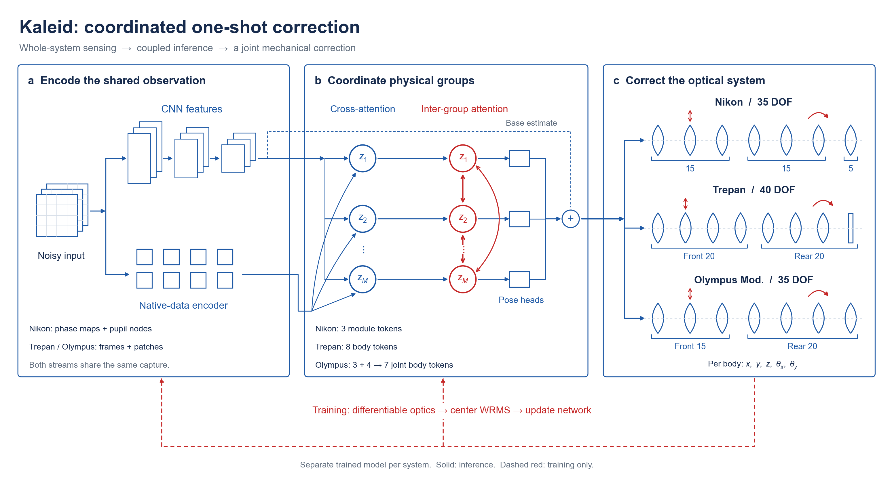

# DAO / Kaleid

**Train Kaleid for coordinated one-shot optical alignment.**

## What is DAO?

**Dynamic Architecture Optics (DAO)** is an optical architecture in which
internal lenses or lens groups can translate and tilt during operation,
allowing their spacing, centering and orientation to be adjusted after assembly
for self-alignment at application time.

In an ordinary objective, lens spacings and centering errors become part of the
as-built prescription. DAO instead treats selected lens or mirror groups as
measured, movable coordinates. The architecture specifies the movable optical
groups, their observable motions, sensor placement, and coordination with faster
phase correction. Moving an internal group changes both aberrations and the ray
footprint on downstream optics, so corrections must account for the whole assembly.

## What is Kaleid?

**Kaleid is the alignment algorithm for DAO.** This repository implements its
current one-shot form: **one whole-system observation packet, one network
evaluation, one coordinated correction.**

A single observation supplies both multiscale CNN features and native measurement
features. Cross-attention conditions physically indexed tokens on the observed
data; inter-group attention exchanges information across the assembly. Pose heads
supply residual predictions, added to base estimates before the instrument-specific
command sign, scaling and bounds. The output jointly addresses the movable bodies.

During **offline training**, differentiable optics evaluates the corrected
prescription and supplies a center-wavefront loss, alongside pose and
system-specific mechanical terms. During **online inference**, the model consumes
the measured packet and produces the correction. Optical simulation and pose
labels stay in the training path. A packet can contain several fields and does
not necessarily mean one camera exposure.



## Train Kaleid

The main contribution of this code release is the **training implementation**:
trainable networks, three float64 differentiable optical models, physical loss
functions, explicit data splits, AdamW recipes, validation-based model selection,
and resumable training. The included checkpoints are examples of trained models.

Python 3.11+, NumPy and PyTorch are sufficient for the packaged training and
inference paths. CPU and CUDA are supported. The fixed prescriptions and ray-launch
calibrations are included; no local research directories or live RayOptics
installation are needed to evaluate these training losses.

```shell
git clone https://github.com/TomaKakuei/DAO-Kaleid.git
cd DAO-Kaleid
python -m pip install .

# Exercise a real forward/backward/update step with tiny synthetic inputs.
kaleid-train nikon --smoke --device cpu --output outputs/smoke-nikon
kaleid-train trepan --smoke --device cpu --output outputs/smoke-trepan
kaleid-train olympus --smoke --device cpu --output outputs/smoke-olympus
```

The smoke checks use sensor-shaped packets with arbitrary labels. They test the
training code, not optical recovery accuracy. For actual training, provide paired
observations and normalized initial poses using the [dataset format](docs/TRAINING.md#data).

```shell
# Random network parameters; system calibration is loaded separately.
kaleid-train trepan --data data/trepan/manifest.json --output runs/trepan --device cuda

# Resume the saved optimizer, RNG and next batch.
kaleid-train trepan --data data/trepan/manifest.json --output runs/trepan --device cuda --resume

# Optionally fine-tune an included model on matched observations.
kaleid-train olympus --data data/olympus/manifest.json --output runs/olympus-ft --device cuda --init pretrained
```

See **[Training guide](docs/TRAINING.md)** for data, calibration, optical objectives,
the three recipes, memory controls, and the scope of reproducibility.

| Training component | Code |
| --- | --- |
| CNN, native measurement branches and group attention | [`src/kaleid/models`](src/kaleid/models) |
| Physical objectives and validity rules | [`objectives.py`](src/kaleid/training/objectives.py) |
| Differentiable ray propagation and mechanical geometry | [`training/physics`](src/kaleid/training/physics) |
| Training, validation, checkpoint selection and resume | [`runner.py`](src/kaleid/training/runner.py) |
| NPZ data adapter and joint/prior sampling | [`data.py`](src/kaleid/training/data.py) |

## Supported systems and inference

| System | Observation packet | Coordinated output |
| --- | --- | --- |
| Nikon | 3 × 49 wavefront samples | 35 coordinates / 7 bodies, coordinated through 3 module tokens |
| Trepan | 9 × 128 × 128 camera ADU | 40 coordinates / 8 body tokens |
| Olympus Mod. | 9 × 128 × 128 whole-system camera ADU | 35 coordinates / 7 body tokens |

For Olympus Mod., the front and rear encoders receive the **same entire nine-field
image stack**; joint seven-body attention coordinates their outputs. Each optical
system has its own sensor channels, calibration and fitted weights. Extending to
a different prescription requires the corresponding optics, measurement model
and training data.

The training output `best.pt` loads directly into the predictor:

```python
import numpy as np
from kaleid import Kaleid

aligner = Kaleid("trepan", checkpoint="runs/trepan/best.pt", device="auto")
command = aligner.predict(np.load("observation.npy", allow_pickle=False))
physical_command = aligner.to_physical(command)  # mm and degrees
```

Omit `checkpoint` to use the included example model. The existing eleven-case
simulations reached the center-field target for 11/11 cases per system; details,
selected epochs and the limits of those results are in the [model card](docs/MODEL_CARD.md).

[Training guide](docs/TRAINING.md) · [Input/output contract](docs/API.md) ·
[Architecture PDF](docs/architecture.pdf) · [Editable SVG](docs/architecture.svg)

```shell
python -m unittest discover -s tests -v
```
